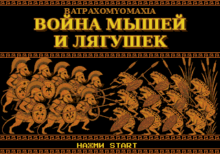

# Война мышей и лягушек (Batrachomyomachia) — шашки для Sega Mega Drive / Genesis

Шашки на картридже Sega Mega Drive в стиле античной вазописи. Мыши-гоплиты царя Троксарта сражаются с лягушками царя Физигната. Сюжет взят из пародийной древнегреческой поэмы «Батрахомиомахия».



## Возможности
- **Правила:** по умолчанию русские шашки (дамка ходит на любое расстояние, бить обязательно, простые бьют назад, «турецкий удар», шашка, ставшая дамкой во время взятия, продолжает бить как дамка). Можно включить английские правила (checkers).
- **Режимы:** 1 игрок против компьютера (за мышей или за лягушек; доска поворачивается к игроку) или 2 игрока за одной приставкой. Второй геймпад тоже работает.
- **ИИ:** альфа-бета (negamax) с итеративным углублением и продлением взятий. Три уровня: Легко, Средне и Трудно.
- **Интерфейс:** подсветка возможных ходов и последнего хода. Многоходовое взятие выбирается поклеточно. Взятие анимировано: «удар» по мыши, «всплеск» по лягушке. Есть анимация превращения в дамку (царя в короне), меню паузы и отмена хода.
- **Вступление:** пересказ поэмы в пяти «песнях» с эффектом пишущей машинки, кириллический шрифт из тайлов.
- **Экраны победы, поражения и ничьей.** При ничьей «Зевс послал на поле раков», как в финале поэмы.
- **Музыка и звук:** оригинальная музыка для драйвера XGM2 (кифара и авлос на FM, рамочный барабан на PSG, дорийский лад) и PCM-эффекты.

## Управление
| Кнопка | Действие |
|---|---|
| Крестовина | курсор |
| A / C | выбрать шашку / поставить на клетку (при многократном взятии — каждую клетку пути) |
| B | отменить выбор |
| START | пауза: продолжить, отмена хода, выход в меню |

## Сборка
Нужен SGDK 2.11 и кросс-компилятор m68k. С официальным тулчейном SGDK достаточно `make -f $GDK/makefile_wingdk.gen` (Windows) или `make -f $GDK/makefile.gen`. В `tools/sgdk.mk` лежит упрощённый Makefile для Linux (Debian `gcc-m68k-linux-gnu` + `libgcc.a` из SGDK).

Генерация ресурсов:
```
python3 tools/gen_assets.py   # тайлы, палитры, титульный экран -> src/gfx_data.c, res/title.png
python3 tools/gen_music.py    # VGM-музыка и WAV-эффекты -> res/music, res/sfx
```

Тесты правил и ИИ (на ПК):
```
gcc -O2 -Wall -o tests/test_rules tests/test_rules.c src/rules.c src/ai.c && ./tests/test_rules
```
Тесты проверяют perft (английские шашки d1–8: 7…845931, русские d1–7: 7…190146), позиционные тесты правил и партии ИИ против ИИ.

## Графика и звук
Вся графика нарисована процедурно скриптом `tools/gen_assets.py` и приведена к 9-битной палитре Mega Drive (4 палитры по 16 цветов): щиты-гоплоны, меандры, ионическая колонна, доска. Исходные силуэты и фриз в стиле краснофигурной вазописи (`tools/src_art`) сгенерированы специально для проекта. Кириллица растеризована из шрифта Press Start 2P (SIL Open Font License). Музыка и звуки синтезированы скриптом `tools/gen_music.py`.
